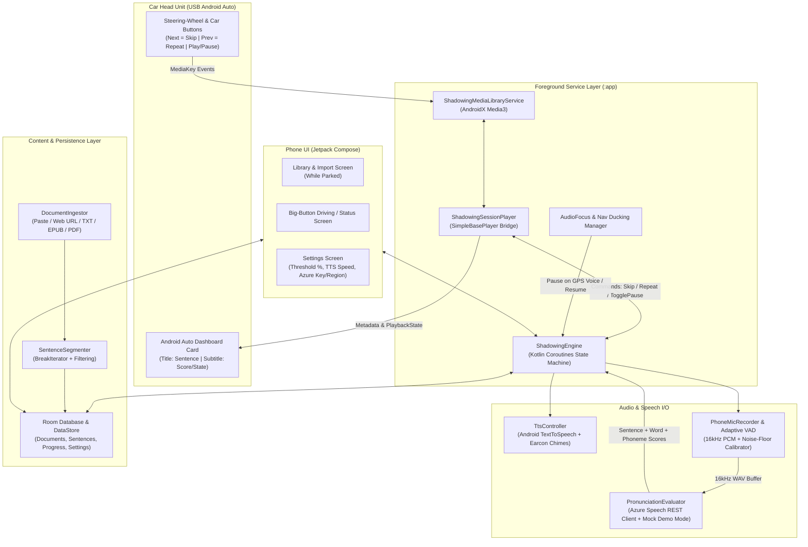
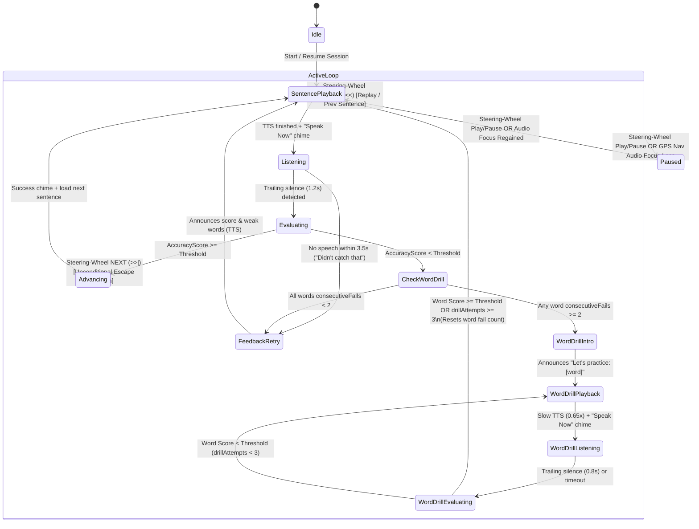

# Hands-Free Driving English Shadowing App — Architecture & Design Spec

**Date:** 2026-11-21  
**Target Platform:** Android (Kotlin, Jetpack Compose, AndroidX Media3, USB Android Auto)  
**Sizing:** Project (Full Written Design + Prioritized MVP Plan)

---

## 1. Intent & The Why

Language learners who find open-ended conversation prompts overwhelming often thrive on **structured sentence shadowing**: hearing a well-formed sentence, repeating it immediately, getting objective pronunciation feedback, and drilling trouble words until fluent.

Commuting by car offers 30–90 minutes of private daily vocal practice time, but existing language apps require looking at and tapping a phone screen. This application turns a daily drive into an **eyes-free, hands-free English pronunciation coach** integrated directly with **wired USB Android Auto** and the car's **steering-wheel media controls**.

---

## 2. Goals, Non-Goals, and Anti-Goals

### Goals
1. **100% Eyes-Free / Hands-Free Driving Loop:** Once a text source is started, the entire cycle—TTS playback, microphone capture, pronunciation evaluation, spoken error feedback, adaptive single-word slow drilling, and sentence progression—runs automatically without screen interaction.
2. **True Phoneme & Word Pronunciation Scoring:** Use **Azure AI Speech Pronunciation Assessment** (reference-text forced alignment and Goodness-of-Pronunciation scoring) rather than standard Speech-to-Text (which silently auto-corrects mispronounced words using language-model context).
3. **Zero-Fail Hardware Escape Hatch via USB Android Auto:** Bind steering-wheel media buttons (`Next`, `Previous`, `Play/Pause`) and the Android Auto dashboard media card via AndroidX Media3 (`MediaLibraryService`), eliminating the fragility of voice commands in noisy car cabins.
4. **Threshold Gating & Adaptive Word Micro-Drills:** Block automatic progression until the user meets their configurable accuracy threshold (e.g., 80%). Automatically isolate words mispronounced across consecutive attempts into a slowed-down (0.65x) single-word drill before returning to the full sentence.
5. **Phase 1 Content Ingestion:** Support pasted text, public web article URLs, and local digital books/documents (TXT, EPUB, PDF) segmented into practice-sized sentences with persistent reading position.
6. **Non-Driving On-Screen Synchronized Word Highlighting:** When the user is practicing outside the car (or parked) and looking at the phone screen, display the active sentence and **bold the currently spoken word in real-time sync** with TTS audio playback.

### Non-Goals (MVP / Phase 1)
- **Custom Voice Command / Wake-Word Spotting:** Replaced entirely by physical steering-wheel media controls and Android Auto transport buttons.
- **Intranet / VPN Corporate Websites (Phase 2):** Deferred until Phase 2 due to corporate authentication flows while driving.
- **Full Android Auto Browsing Trees:** In the MVP, importing documents/URLs and changing deep settings happen on the phone screen while parked; Android Auto is used for starting/resuming sources, viewing the active sentence/score on the dashboard card, and controlling the loop via steering-wheel buttons.

### Anti-Goals (What Would Make This a Failure Even If It Works Technically)
- **Trapping the Driver on a Sentence:** Road noise, AC fans, or a tricky word must never force the driver to pick up their phone to move forward. A single press of the steering-wheel **Next (`>>|`)** button must unconditionally skip forward.
- **Bluetooth / Audio Mode Switching Blackouts:** Never switch the car head unit back and forth between media mode and hands-free phone-call (HFP) mode between sentences.
- **Recording Turn-by-Turn GPS Voice as User Speech:** When Google Maps or Waze speaks a navigation prompt over Android Auto, the app must immediately pause/abort the current listening turn and restart the sentence cleanly once navigation audio ends.

---

## 3. Constraints & Car Environment Realities

1. **USB Android Auto + Phone Microphone Split Routing:**
   - The user connects the phone to the car head unit via **USB cable running Android Auto**.
   - TTS audio and earcon chimes play through the car speakers over the wired Android Auto media stream (`USAGE_MEDIA` / `CONTENT_TYPE_SPEECH`).
   - User speech is captured at **16 kHz, 16-bit mono PCM** from the **phone's built-in microphone** (`MediaRecorder.AudioSource.VOICE_RECOGNITION`) inside a Foreground Service (`foregroundServiceType="mediaPlayback|microphone"`). This avoids triggering Android Auto's Google Assistant overlay, avoids 8 kHz HFP call compression, and preserves wideband consonant/vowel frequencies required by Azure's phoneme scorer.
2. **Dynamic Ambient Noise Floor in a Moving Car:**
   - Highway noise creates a steady elevated RMS floor. The Voice Activity Detector (VAD) must calibrate a 250 ms ambient baseline immediately before opening the speech window and detect speech onset/offset relative to that baseline (plus hard max-time safety caps).
3. **Sideloaded Android Auto Developer Setting:**
   - Until published on Google Play, Android Auto requires the user to enable **"Unknown sources"** once inside Android Auto's Developer Settings on the phone so the media service appears on the car console.

---

## 4. Architectural Approaches Considered

| Approach | Summary | Trade-offs | Decision |
| :--- | :--- | :--- | :--- |
| **A. USB Android Auto Media3 + Phone Wideband Mic + Azure Pronunciation API** | Media3 `MediaLibraryService` projects metadata & captures steering-wheel keys over USB Android Auto; phone mic captures 16 kHz PCM; Azure REST API evaluates reference text at word/phoneme level. | Requires phone resting in open console/mount (not buried in a closed bag) and mobile data connection (~400–800 ms scoring latency). | **Selected (Decided with User)** |
| **B. Full Bluetooth HFP Call Channel + Car Ceiling Mic + Azure API** | Opens continuous Bluetooth SCO/HFP voice-call channel to use the car's ceiling mic. | Degrades audio to 8 kHz narrowband (hurting phoneme scoring), conflicts with Android Auto media controls, and makes the car stereo display a fake ongoing phone call. | **Rejected** |
| **C. USB Android Auto + On-Device Offline Forced Alignment (Sherpa-ONNX)** | Runs local acoustic forced alignment on the phone CPU without cloud calls. | Offline & free, but +80 MB APK size, fragile under cabin road noise, and lacks Azure's non-native phoneme accuracy calibration. | **Rejected for MVP** |

---

## 5. High-Level Technical Architecture (Android / Kotlin / Jetpack Compose)



### Key Architectural Components

1. **`ShadowingMediaLibraryService` & `ShadowingSessionPlayer` (AndroidX Media3):**
   - Extends `MediaLibraryService` and declares `<meta-data android:name="com.google.android.gms.car.application" android:resource="@xml/automotive_app_desc"/>` with `<uses name="media"/>`.
   - Uses a custom `SimpleBasePlayer` (`ShadowingSessionPlayer`) that announces available commands (`COMMAND_PLAY_PAUSE`, `COMMAND_SEEK_TO_NEXT`, `COMMAND_SEEK_TO_NEXT_MEDIA_ITEM`, `COMMAND_SEEK_TO_PREVIOUS`, `COMMAND_SEEK_TO_PREVIOUS_MEDIA_ITEM`).
   - Maps steering-wheel and car-screen actions directly to `ShadowingEngine`:
     - **`seekToNext()` / `Next (`>>|`)`** $\rightarrow$ `ShadowingAction.Skip`
     - **`seekToPrevious()` / `Previous (`|<<`)`** $\rightarrow$ `ShadowingAction.Repeat`
     - **`play()` / `pause()`** $\rightarrow$ `ShadowingAction.TogglePause`
   - Pushes real-time `MediaMetadata` updates so the Android Auto card always displays:
     - `title`: The active sentence text (or `"Drill: [word]"` during micro-drills).
     - `artist`: Current status and last score (e.g., `"Listening... (Goal: 80%)"` or `"Score: 71% — Retry: thoroughly"`).

2. **`TtsController` & Real-Time Word Sync + Earcon Feedback:**
   - Wraps Android's native `TextToSpeech` engine (`Locale.US` default, configurable speech rate `0.5x–1.5x`).
   - Implements `UtteranceProgressListener.onRangeStart(utteranceId, start, end, frame)` (API 26+) to emit the real-time character range (`start..end`) of the word currently being spoken by the TTS engine.
   - The Jetpack Compose phone UI subscribes to this range via `StateFlow` and renders the active sentence as an `AnnotatedString`, **dynamically bolding the currently spoken word** in sync with the audio playback (with a fallback word-timing estimator if a device's custom TTS engine omits `onRangeStart` callbacks).
   - Plays distinct, brief audio earcons (`ToneGenerator` / synthesized PCM chimes over `USAGE_MEDIA`) so the driver always knows the state eyes-free:
     - **Ready-to-Listen Earcon:** Short rising double-tone right after TTS finishes—signals the mic is open.
     - **Captured Earcon:** Soft single click when speech ends and evaluation begins.
     - **Pass Earcon:** Pleasant major-third chime before advancing to the next sentence.

3. **`PhoneMicRecorder` with Adaptive Car-Cabin VAD:**
   - Captures 16 kHz, 16-bit mono PCM via `AudioRecord(MediaRecorder.AudioSource.VOICE_RECOGNITION, 16000, ...)`.
   - **3-Phase Recording Window:**
     1. **Ambient Calibration (200 ms):** Samples RMS energy right after TTS ends to establish the dynamic cabin noise floor ($E_{\text{noise}}$).
     2. **Wait for Speech Onset (up to 3.5 s):** Waits for frame RMS to exceed $\max(E_{\text{noise}} \times 2.2, E_{\text{min}})$. If no speech starts within 3.5 s, emits `NoSpeechDetected`.
     3. **Active Speech until Trailing Silence:** Records until RMS drops back near the noise floor continuously for **1.2 s** (for full sentences) or **0.8 s** (for single-word micro-drills), up to a dynamic maximum duration of $\max(5.0\text{ s}, \text{ttsDuration} \times 2.0)$.
   - Wraps the captured PCM samples with a 44-byte WAV header in memory for direct upload.

4. **`PronunciationEvaluator` (Azure AI Speech REST API + Offline Demo Evaluator):**
   - Uses Azure's low-overhead Pronunciation Assessment REST endpoint (`https://{region}.stt.speech.microsoft.com/speech/recognition/conversation/cognitiveservices/v1?language=en-US`) with the `Pronunciation-Assessment` Base64 JSON header:
     ```json
     {
       "ReferenceText": "<target sentence or word>",
       "GradingSystem": "HundredMark",
       "Granularity": "Phoneme",
       "Dimension": "Comprehensive",
       "EnableMiscue": true
     }
     ```
   - Why the REST endpoint over the heavy C++ Azure Android SDK:
     - Zero native `.so` bloat, instant Gradle build, full Kotlin Coroutines/OkHttp cancellation support, and single-shot upload of the 2–6 second 16 kHz WAV buffer (~60–180 KB) returns in **400–700 ms**.
   - Parses `NBest[0].PronunciationAssessment.AccuracyScore` (overall score) and each `Words[i]` entry (`Word`, `AccuracyScore`, `ErrorType`, and `Phonemes[]`).
   - Also includes a `MockPronunciationEvaluator` mode in Settings for offline simulator testing before an Azure key is entered.

---

## 6. Hands-Free Audio Loop & State Machine



### State & Transition Rules (Builder Specification)

| Event / Condition | Behavior |
| :--- | :--- |
| **Pass Condition** | `sentenceResult.accuracyScore >= settings.accuracyThreshold` (default `80%`). Plays pass chime, clears per-word fail counters, saves sentence index to Room DB, and starts next sentence. |
| **Fail (< Threshold), First Failure on Word(s)** | Increments `consecutiveFails[word]` for every word with `word.accuracyScore < settings.accuracyThreshold` or `errorType != "None"`. Speaks concise feedback: *"72 percent. Watch: [word1], [word2]."* Pauses 400 ms, then replays the full sentence. |
| **Adaptive Word Micro-Drill Trigger** | When one or more words reach `consecutiveFails[word] >= 2` (configurable, default 2), queues the lowest-scoring failed word for micro-drilling. |
| **Micro-Drill Execution** | Reads *"Let's practice: [word]"*, then speaks `[word]` at **0.65x** speed. Listens for `[word]` and evaluates against Azure with `ReferenceText = [word]`. Once the user achieves `>= threshold` on `[word]` (or after 3 drill tries so they never get stuck), resets `consecutiveFails[word] = 0`, announces *"Good, back to the sentence"*, and replays the full sentence. |
| **Steering-Wheel `Next (>>|)` (Escape Hatch)** | Cancels any active TTS/recording/API call immediately, resets drill state, increments to the **next sentence**, and starts `SentencePlayback`. If pressed while inside a `WordDrill`, skips the drill AND advances to the next sentence so one tap always rescues the driver. |
| **Steering-Wheel `Previous (|<<)`** | If pressed more than 3 seconds into the current sentence attempt, restarts `SentencePlayback` for the **current sentence** (or current drill word). If pressed within the first 3 seconds of a new sentence, steps back to the **previous sentence**. |
| **Steering-Wheel `Play / Pause`** | Immediately pauses active TTS, recording, or evaluation and enters `Paused`. Pressing again resumes from `SentencePlayback` of the current sentence. |
| **GPS Navigation Audio Interruption** | On `AUDIOFOCUS_LOSS_TRANSIENT` or `AUDIOFOCUS_LOSS_TRANSIENT_CAN_DUCK` (e.g., Google Maps turn prompt), immediately aborts any open mic recording so GPS voice is not scored, waits for `AUDIOFOCUS_GAIN`, and cleanly restarts `SentencePlayback` for the current sentence. |

---

## 7. Content Ingestion & Sentence Segmentation (Phase 1 MVP)

1. **Supported Input Formats:**
   - **Pasted Text:** Direct text input with a title.
   - **Public Web URL:** Fetches HTML via OkHttp and extracts clean article paragraphs using Jsoup (stripping navbars, scripts, ads, and footers).
   - **Local Files (Storage Access Framework `OpenDocument`):**
     - **`.txt`**: Direct UTF-8 text read.
     - **`.epub`**: Unzip container in Kotlin, parse `META-INF/container.xml` $\rightarrow$ `.opf` spine order $\rightarrow$ strip XHTML tags via Jsoup in chapter order.
     - **`.pdf`**: Extract text locally using `PdfBox-Android` (`com.tom-roush:pdfbox-android`).
2. **Sentence Segmentation Rules (`SentenceSegmenter`):**
   - Uses `java.text.BreakIterator.getSentenceInstance(Locale.US)` after normalizing whitespace and common abbreviations (`Mr.`, `Dr.`, `U.S.`, etc.).
   - Filters out non-speakable lines (page numbers, URLs, table of contents dots, sentences shorter than 2 alphabetic words).
   - Splits overly long compound sentences (> 30 words) at semicolons or em-dashes so each shadowing turn stays within a comfortable working-memory span (~5–22 words) while driving.

---

## 8. Decisions & Builder Calls

### Decided with Human Partner
- **Car Integration:** Wired USB Android Auto connection.
- **Hands-Free Controls:** Steering-wheel media buttons (`Next`, `Previous`, `Play/Pause`) and Android Auto dashboard media transport controls replace custom voice commands completely.
- **Audio & Scoring Architecture:** Approach A — AndroidX Media3 playback over USB Android Auto + phone wideband microphone (`VOICE_RECOGNITION` 16 kHz) + Azure AI Speech Pronunciation Assessment.
- **Core Learning Mechanics:** Configurable threshold gating, spoken feedback identifying mispronounced words, and automatic slow-speed micro-drilling on repeatedly mispronounced words.
- **On-Screen Non-Driving Mode:** Displays the current sentence on the phone screen and **bolds each word in real-time sync** as TTS speaks it (`UtteranceProgressListener.onRangeStart`).
- **Content Scope:** Phase 1 covers Pasted Text, Public Web URLs, and Local Files (TXT, EPUB, PDF); Intranet sites are deferred to Phase 2.

### Builder Calls (Default Decisions You Can Override)
1. **Azure Speech REST API vs. Native SDK:** Use Azure's Pronunciation Assessment REST API over OkHttp instead of the heavy native C++ Speech SDK. It returns identical JSON word/phoneme scores for 2–6 second utterances with zero native binary bloat.
2. **Mock / Demo Evaluator Mode:** Include an optional **"Offline Demo Scorer"** toggle in Settings (alongside the Azure API Key & Region fields) so you can test the entire Android Auto state machine, micro-drill loop, and steering-wheel buttons immediately even before plugging in an Azure key.
3. **Micro-Drill Thresholds:** Trigger a word micro-drill after **2 consecutive failures** on the same word; play the drill word at **0.65x** speed; return to the full sentence as soon as the word passes OR after **3 micro-drill attempts** (so a driver is never trapped in an infinite loop).
4. **Network Error Handling While Driving:** If mobile data drops briefly in a tunnel or dead zone, announce *"Connection lost, retrying"* once and automatically retry the evaluation; if it fails twice, announce *"Offline, press Next to skip or Pause"* without crashing or dropping the session.

---

## 9. Prioritized MVP Implementation Scope

To get a working prototype running on your phone and Android Auto quickly, we build in four vertical slices:

1. **Slice 1 — Core Shadowing Engine & Audio Loop:**
   - Kotlin project scaffolding (Jetpack Compose, Media3, Room, DataStore, OkHttp).
   - `TtsController` (adjustable speed + earcon chimes), `PhoneMicRecorder` (16 kHz WAV + adaptive noise-floor VAD), and `PronunciationEvaluator` (Azure Speech REST API + Mock Demo Scorer).
   - `ShadowingEngine` coroutine state machine implementing Playback $\rightarrow$ Listen $\rightarrow$ Evaluate $\rightarrow$ Threshold Gate $\rightarrow$ Adaptive Word Micro-Drill.
2. **Slice 2 — USB Android Auto & Steering-Wheel Integration:**
   - `ShadowingMediaLibraryService` + `ShadowingSessionPlayer` + `automotive_app_desc.xml`.
   - Steering-wheel `Next` (Skip), `Previous` (Repeat), `Play/Pause` mapping, live Android Auto metadata card updates, and GPS navigation audio-focus pause/resume protection.
3. **Slice 3 — Content Ingestion & Persistence:**
   - Room database for documents, segmented sentences, and current sentence cursor.
   - `SentenceSegmenter` + importers for Pasted Text, Public Web URLs (Jsoup), and Local Files (`TXT`, `EPUB`, `PDF`).
4. **Slice 4 — Phone UI (Parked Setup & Big-Button Driving View):**
   - Library / Import screen, Big-Button Active Session screen (mirrors Android Auto controls and live word-colored score transcript), and Settings screen (Accuracy Threshold %, Speech Rate slider, Drill Trigger count, Azure Key/Region, Demo Mode toggle).

---

## 10. What's Left to the Builder
- Exact Room schema and DataStore preference keys.
- Compose theme styling (high-contrast dark palette suitable for car cabins).
- Unit tests for `SentenceSegmenter`, WAV header encoding, Azure JSON response parsing, and `ShadowingEngine` state transitions (including word micro-drill entry/exit and steering-wheel interrupts).
